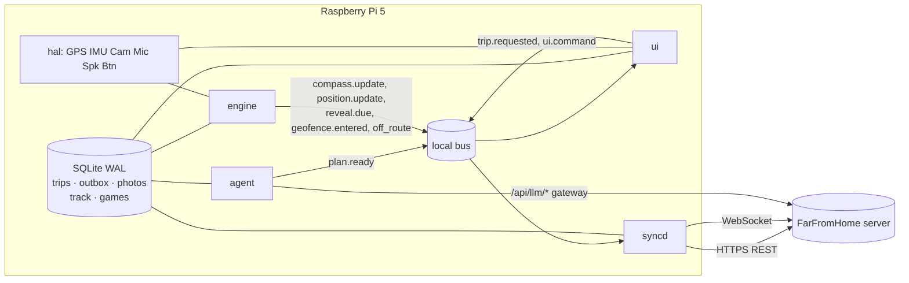

# Architecture

The handheld is four processes and a shared set of services. This document explains
the shape, the reasons for it, and where each piece of the brief's requirement list
is satisfied.

---

## 1. Process model

The brief (§5.0) asks for four processes so that one can be restarted without
killing the others. That is exactly what the `systemd/` units do:

| Process | Module | Responsibility | Restart impact |
|---|---|---|---|
| `agent` | `app/processes.py:run_agent` | planning, on-demand LLM calls | nothing in flight is lost; it only runs when a trip is requested |
| `engine` | `app/processes.py:run_engine` | the deterministic live loop, **no LLM** | the arrow freezes for a second, then resumes from SQLite |
| `ui` | `app/processes.py:run_ui_process` | screens, input, audio, camera, games | the panel blanks; the trip keeps running |
| `syncd` | `app/processes.py:run_syncd_process` | outbox, uploads, retries | uploads pause; nothing is lost |

`python -m farfromhome_device.app.main all` runs all four in one process for a small
Pi or for debugging, and `run.py --simulate` does the same on a laptop. Both paths
build the same components, so a bug cannot hide in one of them.



---

## 2. The bus

```python
infra.bus.subscribe("compass.update", on_compass)
infra.bus.publish("trip.started", {"trip_id": ...}, source="engine")
```

* `core/bus.py` implements topics, `fnmatch` wildcard subscriptions, request/reply,
  and JSON envelopes (`BusMessage`).
* `LocalBus` (default) is in-process. `ZmqBus` is a documented seam behind the same
  API for the four-process Pi deployment; the reasoning is in
  `DECISIONS.md` D-02, and the honest summary is: a ZeroMQ or MQTT daemon on Windows
  is a new developer's first bad afternoon, and the brief's stronger requirement is
  "runs on a laptop".
* Topics are the brief's list plus a documented extra set
  (`core/models.py:BUS_TOPICS` and `EXTRA_BUS_TOPICS`). `validate_topic()` is a typo
  guard the tests use.

### Why "the UI is a view of the bus" matters

No screen holds a `Plan`, a `DeviceClient` or the engine. A screen receives
payloads. Two consequences that are worth the indirection:

1. The four-process split works with zero changes to the screens.
2. **A screen physically cannot leak the destination before the reveal**, because
   the only place a destination name exists is the `trip.arrived` payload and
   `RevealEngine.safe_plan_view()` after the reveal has fired. This is the
   "mystery first" principle enforced by the architecture rather than by care.

---

## 3. Layers

### Layer 1 — agent (`agent/`)

```
TripSpec  →  tools  →  score in code  →  LLM writes text  →  Plan (validated)
```

* `input_parser.py` — three ways in, in order: buttons (always works), a keyword
  heuristic (offline, deterministic), then an LLM that fills `TripSpecDraft`. The
  LLM result is *merged on top of* the heuristic, so a vague answer cannot lose a
  field the user set by hand. Every default is recorded in
  `TripSpec.defaults_applied` so the UI can say what it assumed.
* `tools.py` — the brief's five tools, each behind an interface with an offline
  implementation: `OverpassPlaces` / `GooglePlaces` / `OfflinePlaces`,
  `OsrmRouting` / `StraightLineRouting`, `NullReviews` / `RatingFromTags`,
  `SafetyChecker`, `SocialSignals` (a stub that returns nothing, by design).
* `score_candidate()` — all the judgement is here, in code, explainable and
  testable: interest match, range fit, time fit, rarity, reviews, social, and a
  safety penalty. `ScoredCandidate.reasons` is why a place won.
* `llm_router.py` — `ask_llm(task, schema, ...)` behind a failover chain. Keys live
  on the **server** in production; `LLM_DEV_MODE=true` is the laptop-only escape
  hatch. Every prompt is passed through `redact_for_llm()`.
* `schemas.py` — the **entire** LLM surface. There is no destination-name field
  anywhere in it, which is how the mystery survives contact with a language model.
* `template.py` — built-in game items and a complete template plan, used when the
  LLM fails. A template plan is a real, walkable plan, marked
  `fallback.used = True` with the reason.

### Layer 2 — engine (`engine/`)

Deterministic, no LLM calls, testable without hardware or time.

* `fusion.py` — the complementary filter. Weights are computed *per sample* from
  measurements, so the filter degrades rather than lies: the magnetometer's weight
  falls with field-magnitude deviation and drops during a fast turn; GPS course
  contributes only while moving.
* `compass.py` — the arrow. `CompassUpdate` has no distance field and a unit test
  asserts that, because the brief's rule is "never display distance to the
  destination". The only distance calculation anywhere near the destination is
  `distance_only_for_arrival()`, whose single caller is the arrival check.
* `reveal.py` — `never` / `on_proximity` / `on_arrival` / `at_time`, each firing
  exactly once. `RevealEngine.safe_plan_view()` is what the UI may draw.
* `geofence.py` — zones with hysteresis, plus the off-route detector: a
  distance-from-path check that only warns after the user has been off the line for
  a dwell period (default 45 s), because the brief insists the user chooses their
  own way.
* `state_machine.py` — `TripEngine`, the loop: read GPS and IMU → fuse → bearing →
  `compass.update` → geofences → reveals → off-route → track log. Everything local,
  so it runs offline.

### Layer 3 — UI and games (`ui/`, `games/`)

* `ui/widgets.py` — `CompassWidget` (no way to set a distance), `PersonaWidget`,
  `QrCard`, `TileGrid`, `TickerList`, `CountdownLabel`.
* `ui/app.py` — the Qt shell, the `AsyncBridge` (asyncio on its own thread, bus
  messages drained on a 60 ms timer), and every screen.
* `ui/persona.py` — the agent's voice, and push-to-talk. TTS goes through the HAL
  speaker (Piper on the Pi); STT is Vosk or Whisper **if installed**, otherwise the
  button path, which the brief requires anyway.
* `ui/headless.py` — the same payloads as text, for CI and for a Pi with no display.
* `games/` — `GameModule` (`on_start`, `on_event`, `on_photo`, `score`, `on_end`),
  `PhotoHuntGame`, `BingoGame`, and `GameHost`, which is brief 02 Part B: the
  handheld requests the session, draws the QR, runs the lobby and timer, and ends
  the game from any of the four triggers. `LocalScoreboard` copies the server's
  rules so an offline game produces the same winner. Content lives in
  `games/templates/games.yaml` — adding a game is a YAML file, not code.

---

## 4. Data

One SQLite database, WAL mode, at `DATA_DIR/outbox.db`:

| Table | What it holds | Why it matters |
|---|---|---|
| `trips` | one row per trip plus the validated `Plan` JSON | the engine and the UI both read it; a restart resumes |
| `track_points` | the downsampled track | the wrap-up map and the distance |
| `outbox` | the offline queue | strict order, backoff, idempotency |
| `photos` | photo metadata and local file paths | a local copy exists until the server confirms and the trip is finished |
| `game_sessions` | local game state | a game survives a restart; the offline fallback records its result |
| `events` | an append-only log | "why did it do that" after the fact |
| `meta` | key/value | schema version, cached plan, last demo flag |

Photos are on disk under `DATA_DIR/trips/{trip_id}/photos/`. Nothing large is ever
in a row.

---

## 5. Offline-first sync (brief §7, 03 §5)

```
engine  --(ui.command: queue_points)-->  syncd/outbox  --(HTTP)-->  server
```

The engine performs **no network I/O**. It publishes an intent; `syncd` owns the
queue. One queue, strict `id` order, so a trip is always created before its points.
Backoff is 2, 4, 8, 16, 32, then 60 seconds. `409` is final (duplicate or
`game_closed`); `400/422` is dropped as unfixable; `401` stops the queue, keeps the
row, and triggers re-pairing; `404/408/425/429/5xx` retry.

SOS is the single exception: sent immediately with a 5 s timeout **and** queued,
then retried every 15 s.

---

## 6. Failure handling (brief §12)

| Failure | What happens | Where |
|---|---|---|
| No internet mid-trip | everything runs from cache; the queue drains later | `local bus`, `outbox` |
| LLM down or rate-limited | the chain fails over; then the template content | `llm_router.ask`, `planner._write_copy` |
| Invalid LLM JSON | one retry per provider, then the template | `llm_router._validate` |
| GPS lost | the arrow freezes, `sensor.gps_lost` fires once, `searching` shows | `engine._check_gps_loss` |
| Magnetometer noisy | its weight falls to zero; gyro and GPS course carry the heading; `needs_calibration` prompts the figure-8 screen | `fusion` |
| Battery low | `set_backlight()` on the HAL display; non-essential loops are already idle | `hal`, `systemd Nice/CPUWeight` |
| Phone fails to join | Local game mode on the handheld, no QR | `GameHost.enable_offline_mode` |
| Process crash | `Restart=always` in systemd, state from SQLite | `systemd/*.service` |
| Server unreachable at game start | the reason comes from `net/diagnostics.py`, with fixes, plus a Retry button | `GameHost.diagnose` |

---

## 7. Safety (brief §11)

* **Public places only** — `core/safety.py:is_public_place` filters candidates
  *before* scoring, so a charming private property cannot win.
* **Daylight** — warns when arrival is projected after dark.
* **Emergency contact** — a plan carries the flag; `sos_payload()` sends the current
  fix and the trip id.
* **SOS** — try immediately, queue a copy, repeat every 15 s, and log locally when
  there is no server at all.
* **Privacy** — EXIF is stripped locally (and again by the server), and every LLM
  prompt goes through `redact_for_llm()`.
* **Stranger meetups** — `safety.strangers_allowed_default()` returns `False`. That
  function is the single switch the feature checks and it stays off until the
  Section 15 age question is answered.

---

## 8. Testing

| Kind | Where | What it proves |
|---|---|---|
| maths | `tests/test_geo.py` | bearings, distances, the off-route segment maths, daylight |
| engine | `tests/test_engine.py` | M1: the replay triggers geofences in order, reveals fire once, GPS loss and recovery |
| queue | `tests/test_outbox.py` | one row per rule in the brief's status table, ordering, backoff, durability across a restart |
| QR | `tests/test_qr.py` | the localhost rewrite rules, error correction M, the quiet zone |
| planner | `tests/test_planner.py` | 20 varied specs, dead providers, prompt redaction, no place name in the prompt |
| games | `tests/test_games.py` | the server's scoring rules, the host state machine, offline fallback |
| network | `tests/test_net.py` | pairing, status handling, multipart uploads, the WebSocket |
| **live server** | `tests/test_server_integration.py` | the real API: pairing, trip, points, photo, arrival, game lifecycle, SOS (skipped when nothing is listening) |

339 tests run in about 17 seconds with no hardware, no network and no API keys.

---

## 9. Repository layout

```
phone-app/
  run.py                          entry point: --simulate --demo --self-test --pair --topics
  farfromhome_device/
    core/     config · models · db · bus · clock · safety · photos · infrastructure
    hal/      base · sim · real  (+ __init__ builds the right bundle)
    engine/   geo · fusion · compass · reveal · geofence · state_machine
    agent/    planner · tools · llm_router · schemas · template · input_parser
    ui/       app · widgets · persona · headless · screens/theme
    net/      pairing · outbox · client · websocket · syncd · qr · diagnostics
    games/    base · photo_hunt · bingo · host · template_loader · templates/games.yaml
    wrapup/   collage · stamp
    app/      processes (the four roles) · main (the systemd entry point)
  tools/      fake_phone · gpx_replay · plan_fuzzer
  tests/      the suite above
  systemd/    five units (four roles, plus all-in-one)
  deploy/     install-pi.sh · dev.sh
  docs/       this file and the rest
```
